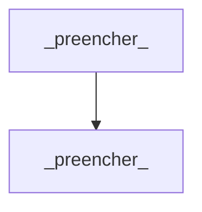

# Architecture Decision Record — _[preencher: nome da Feature]_

_Breadcrumb: [Feature](./FEATURE.md) > [Plan](./PLAN.md) > Architecture_

**Gerado por**: `skills/04-architecture-assessment` · **Atualizado por**: `skills/22-generate-architecture-context`
**Tier de modelo usado**: Forte + High (obrigatório, ver `process/08-model-orchestration.md`)

## Contexto
_[preencher: qual problema técnico está sendo resolvido]_

## Stack tecnológica escolhida
| Camada | Tecnologia | Justificativa |
|---|---|---|
| _[preencher]_ | _[preencher]_ | _[preencher]_ |

## Alternativas descartadas
- **_[preencher]_**: descartada porque _[preencher]_.

## Diagrama de contexto (C4 / Mermaid)

_(gerado/validado por `skills/20-diagram-authoring`)_

## Decisões voláteis isoladas
_[preencher: quais integrações externas ou regras mutáveis foram isoladas atrás de interfaces estáveis — base agentes-ia/ARCHITECT.md]_

## Consequências
- _[preencher: o que essa decisão facilita]_
- _[preencher: o que essa decisão custa/limita]_

## Conformidade com gates
- [ ] Sem hardcode de ambiente (`process/10-core-agnosticism-gate.md`)
- [ ] Decisão registrada com alternativas e consequências (`process/05-definition-of-done.md`)
