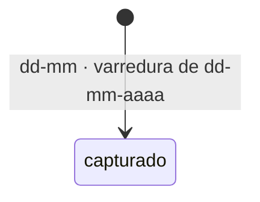

# Título do assunto

## Trajetória

## O que foi pedido

Uma frase, sem interpretação.

## Por que

Contexto de negócio, com fonte.

## O que já sabemos

- [[knowledge/regras-de-negocio/exemplo]] — confiança: confirmado

## Lacunas abertas

- [ ] Pergunta que só um humano responde — dono: Nome

## Dossiê

Preenchido pela skill 44.
